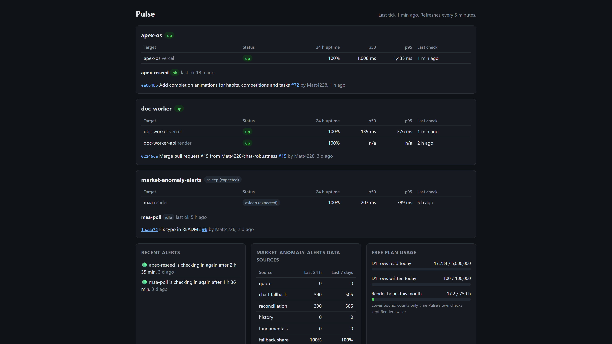

# Pulse

Pulse is a small monitoring service for my side projects. It runs as a single Cloudflare Worker with a D1 (SQLite) database, on the free plan, and answers one question at a glance: **is everything working?**



## What it watches

| Project | Check |
|---|---|
| [apex-os](https://github.com/Matt4228/apex-os) | Uptime, plus a heartbeat from the nightly demo reseed |
| [doc-worker](https://github.com/Matt4228/doc-worker) | Uptime of the frontend and API |
| [market-anomaly-alerts](https://github.com/Matt4228/market-anomaly-alerts) | Uptime during NYSE hours, a heartbeat per poll cycle, and which data source each fetch used |

## How it works

```
apps --(heartbeats + metrics, bearer key)--> +-----------------------------+
                                             |  Worker "pulse"             |
GitHub API <--(every 15 min, read-only)----- |  - ingest API               |
                                             |  - 1 cron trigger, per min  |--> Slack alerts
target URLs <--(uptime checks)-------------- |  - private dashboard        |
                                             |  D1 database                |
UptimeRobot --(every 5 min)--> /health       +-----------------------------+
```

- **Heartbeats, not just pings.** An app reports that its job *succeeded*, not just that it ran. A poll cycle where every fetch failed reports `fail`.
- **One cron trigger.** Each minute the tick decides what is due: uptime checks, heartbeat deadlines, repo activity, daily cleanup.
- **Alerts on changes only.** Down, recovered, late, back on time. Never once per failed check.
- **Who watches the watcher?** An external UptimeRobot check hits `/health`, which reports an error if Pulse's own scheduler has stopped.

## Endpoints

| Route | Auth | Purpose |
|---|---|---|
| `GET /` | Cloudflare Access, owner only | The dashboard. Returns 503 if Access isn't configured, 403 for anyone else |
| `GET /health` | none | 200 while the per-minute scheduler is running, 503 if it has stopped |
| `POST /ingest/heartbeat` | per-app bearer key | `{ "job": "maa-poll", "status": "ok" }` |
| `POST /ingest/metric` | per-app bearer key | `{ "metrics": [{ "name": "source.quote", "value": 12 }] }` |

## Development

Requires Node 22+.

```bash
npm ci
npm test          # Vitest, running inside the Workers runtime
npm run lint
npm run typecheck
npm run dev       # local Worker; copy .dev.vars.example to .dev.vars first
```

Secrets never go in this repo. Locally they live in `.dev.vars` (gitignored); in production they are Worker secrets set with `npx wrangler secret put <NAME>`.
